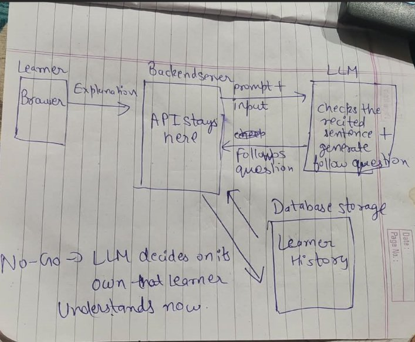
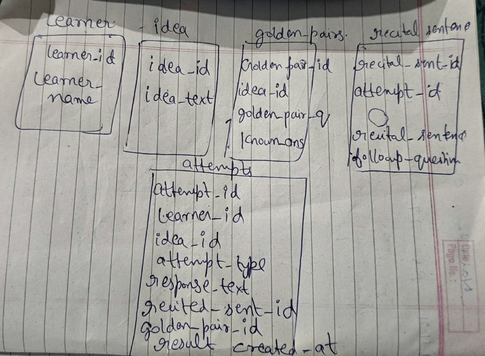

# Concept Check

Find where a learner stops understanding and starts reciting.

Live app: https://c8-db-fastapi.vercel.app/

A learner explains a Module 2 idea in their own words. An AI model quotes the one
sentence that sounds recited and asks one question about what breaks. The learner
tries again, then answers a fresh case they have not seen. **Python decides the
result. The AI can only ask and point at the learner's words.**

## How it works

```
Learner ──► /api/check ──► Groq: quote one sentence, ask one question
                │               (Python checks: quote is in the text, exactly one question)
                ▼
        explanation + retry saved as practice events (no grade)
                │
Learner ──► /api/assessment/case ──► an unseen case for that concept (signed, 30-minute challenge)
Learner ──► /api/assessment/answer ─► Python grades the answer against reviewed rules
                                       └─ optional: Groq proposes quotes, Python confirms them
```

| Decided by code (same input, same answer) | Decided by AI (judgment) |
|---|---|
| The list of concepts (`concept_app/catalog.py`) | Finding the recited sentence |
| The cases and their reviewed answers (`golden_pairs.json`) | Writing the one follow-up |
| Every attempt, with a time and an event type | Proposing which words state an idea (only a proposal) |
| Pass or not, against the answer key | |

### How grading works (`concept_app/verification/`)

1. **Phrase rules** (`patterns.py`) look for each idea a case needs (`rules.py`)
   and for known bad advice (for example "keep the key in the browser").
2. **Quote check** (`quotes.py`). For ideas the phrase rules missed, the model may
   propose the exact passage that states the idea. Python accepts it only if the
   passage is copied exactly from the answer, and if one real clause in it contains
   every required term, with no negation, quotation or "what if". The model never
   sees the answer key and cannot override bad advice. If the model is down, the
   phrase rules decide alone.
3. **Result.** Pass if every idea is covered and there is no bad advice. Otherwise
   *Almost there (2 of 3 ideas)* or *Not yet*, with what was right and what is missing.

Every graded attempt stores `rule_version` and `source_fingerprint`. If a case's
question or answer changes in the database, grading for it switches off until the
rules are reviewed again.

### Golden pairs

`concept_app/verification/golden_pairs.json` (case IDs 1 to 30, three per concept) is the
only set the grader uses. `concept_check_golden_pairs_20.csv` is the same 30 rows as a
CSV, generated from that JSON (the file name is kept so existing links work). Cases 21 to 30
are case variants added after trainer feedback: fresh scenarios that need the same ideas
as a proven case. An earlier draft CSV used IDs 11 to 30 with different
questions; it was never used for grading and has been replaced.

## Measuring fairness

`evaluation/` holds answers a human labelled correct or incorrect.
`scripts/measure_unfair_rate.py` reports the **unfair NOT YET rate** (correct answers
not passed) and the **unsafe PASS rate** (incorrect answers passed), using the phrase
rules only (the live quote check can only add passes it can prove).

| Answer set | Rules 1.0.2 (before feedback) | Rules 1.1.0 | Rules 1.2.0 (now) |
|---|---|---|---|
| **`real_answers.csv`: 11 real learner answers from the live app** (no names; labelled by the builder against the golden answers) | **5 of 5 unfair** | **5 of 5 unfair** | **0 of 5 unfair** ¹ |
| `sample_answers.csv`: the trainer's 2 failing answers + 25 authored | 20 of 27 unfair | 0 of 27 | 0 of 27 ¹ |
| `heldout_answers.csv`: 16 authored answers never tuned on | 11 of 16 unfair | 5 of 16 | 5 of 16 |
| Incorrect answers passed, all sets (26) | 0 | 0 | 0 |

¹ Rules 1.2.0 were written from these answers, so this "after" number is optimistic.
The held-out row is the honest estimate for unseen wording: phrase rules fix what they
have seen. The next round of real learner answers is the true test.

Version 1.2.0 also changed one rule: case 2 asks "what information should the request
carry?", and real learners answered with the order ID and where it goes. Requiring them
to also name the operation rejected correct answers, so that check was dropped.

To measure on new real answers: export graded attempts from Supabase (no names), label
each one, save as CSV with columns `case_id,human_label,answer`, then run
`python scripts/measure_unfair_rate.py your_file.csv`.

## Run locally

```bash
python -m venv .venv && source .venv/bin/activate
pip install -r requirements-dev.txt
cp .env.example .env   # then fill in the values
uvicorn api.index:app --reload
```

## Test

```bash
python -m pytest -q
```

Tests make no network calls. They cover every golden pair, the labelled sample
answers, a model that tries to pass everyone, keyword lists, signed sessions,
practice events, duplicate answers, and rate limits.

## Environment variables

| Name | Purpose |
|---|---|
| `GROQ_API_KEY` | Probing and quote proposals |
| `SUPABASE_URL`, `SUPABASE_SERVICE_KEY` | Database (server only) |
| `SESSION_SECRET` | Signs session cookies and case challenges. Must be different from the Supabase key, 32+ characters |

## Database

Tables: `learners`, `cases`, `attempts`, `gaps`. Apply `migrations/001_events_and_grading_provenance.sql` (and, after deploying rules 1.3.0,
`migrations/002_case_variants.sql`)
in the Supabase SQL editor **before** deploying this version. It adds `event_type`
(`explanation`, `retry`, `graded`), `idea_id`, `rule_version` and `source_fingerprint`
to attempts, backfills old rows, and adds a unique index so a learner can submit
only one graded answer per case.

## Design notes

The app started on paper. My handwritten notes are in `public/notes/`, and the app shows
them at `/how` ("How I built this") next to what each idea became.

| Who does what | What gets stored |
|---|---|
|  |  |

From paper to app: `golden_pairs` became `cases`; `recital_sentence` became `gaps` (the
follow-up), with the recited sentence saved on the attempt; `idea` became the fixed concept
list in code; `attempt_type` became `event_type`, and each grade also stores its rule version.

## Learn, then check

Each concept opens with a short lesson (`LESSONS` in `concept_app/catalog.py`): the idea,
an everyday analogy, an example and a common trap. "I'm ready" leads into the check:
explain in your own words, one follow-up about what breaks, then a fresh case graded by
Python. Reading first is fine because the check is built to catch reciting. The lesson
can be reopened from the book button in the header, or after a Not yet.

## Words you'll need

Each concept and case card has a closed-by-default box that explains the curriculum words
(attempt, row, foreign key, gap...) in plain language, so learners outside the course are
not failed by vocabulary. The lists live in `concept_app/catalog.py` (`WORDS`). They explain
what words mean, never why or how: `tests/test_words.py` checks that no list meets any
graded idea, and each definition was also read for hints a phrase check cannot see.

## Privacy

Learners get a random label, never a name. The shared view shows explanations,
not names. Consent comes first: ask before recording a classmate thinking out loud.

## Known limits

* Rate limits are kept in memory on each server instance, so they slow bursts but
  are not a global cap. A shared store such as Upstash would make them global.
* Each concept has three reviewed cases. When all are answered, the app says so calmly,
  keeps the practice open, and offers another concept.
* The phrase rules and quote check can still miss correct answers in unusual
  words. The app says so on every Not yet result.
